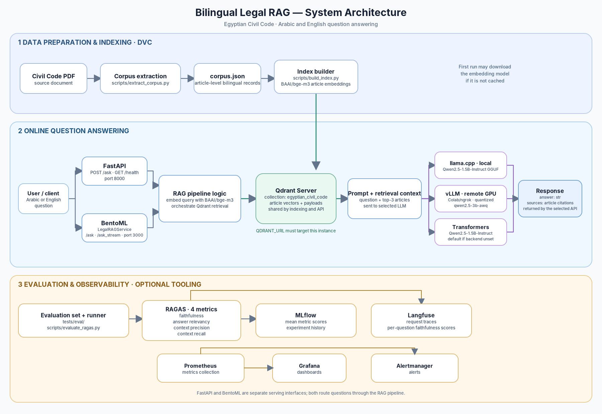

# Bilingual Legal RAG — Egyptian Civil Code
A retrieval-augmented generation system that answers Arabic and English questions
about the **Egyptian Civil Code (Law no. 131 of 1948)** with **article-level
citations**. Final project for the MLOps Practitioner course (LLM/RAG track).

Built for CPU-only environments: the generative model is served by
**llama.cpp** (instructor-approved alternative to vLLM) running a quantized
Qwen2.5-1.5B-Instruct GGUF, and all embeddings run on CPU with bge-m3.

## Why citations matter here

In a legal setting an unverifiable answer is worse than no answer. Every response
returns `sources` as article citations (e.g. `Egyptian Civil Code, Article 147`)
— never chunk IDs or page numbers — so a lawyer can check every claim against
the code itself. Repealed articles (54–80) are flagged in the corpus, not
silently deleted: *"that article no longer exists"* is a valid, verifiable answer.

## Quickstart (3 commands)

Run these three steps from a terminal. Replace `OWNER/REPOSITORY` with the actual
GitHub owner and repository name.

**1. Clone the repository**

```bash
git clone https://github.com/abdelrahman-omran/Bilingual-Legal-RAG.git && cd Bilingual-Legal-RAG
```

**2. Start the services with Docker Compose**

```bash
docker compose up --build -d
```

**3. test connection health**
After it was reviewed, this command will give an error, unless the `dvc repro` run first, since `health/` relies on `documents_indexed` which needs the data to already indexed by `dvc repro`
I would suggest you to follow the **First-time setup for local development** from here, then you will be able to run this command after following the setup 

```bash
#curl localhost:8000/health
```


## First-time setup for local development

Use one of the following options to create the Python environment.

### Option 1: Create a virtual environment and install the project

```bash
uv venv --seed
source .venv/bin/activate
python -m pip install -e .
```

### Option 2: Use `uv sync`

```bash
uv sync
source .venv/bin/activate
```

Both options can work. `uv sync` is recommended when you want the environment
recreated from the project's `uv.lock` file. The virtual-environment option
installs the project and its default dependencies; install any optional groups
separately if you need them.

### Produce the corpus and build the Qdrant index

Start Qdrant, then run the DVC pipeline:

```bash
docker compose up -d qdrant
export QDRANT_URL=http://localhost:6333
dvc repro
```

The first indexing run downloads the `BAAI/bge-m3` embedding model. It is cached
locally, so it normally does not need to be downloaded again on later runs.
Make sure Qdrant is running before `dvc repro` starts the indexing stage.

### Choose an LLM serving method

Choose one of the three backends below. The Hugging Face `transformers` backend
is the default when you do not select `llamacpp` or `vllm`, but the examples set
`LLM_BACKEND` explicitly so the selected backend is clear.

### Option 1: Local llama.cpp — Qwen2.5-1.5B-Instruct-GGUF

Download the GGUF model, then start the `llm` service:

```bash
python scripts/download_model.py
docker compose up -d llm
```

Configure BentoML to use the local llama.cpp OpenAI-compatible endpoint:

```bash
export LLM_BACKEND=llamacpp
export LLM_BASE_URL=http://localhost:8080/v1
export QDRANT_URL=http://localhost:6333

# Inspect the model exposed by llama.cpp
curl -s http://localhost:8080/v1/models

# Start BentoML
bentoml serve legal_rag.serving.bentoml_service:LegalRAGService
```

### Option 2: Hugging Face Transformers — Qwen2.5-1.5B-Instruct

This runs the model locally through Hugging Face Transformers. The model is
downloaded from Hugging Face the first time it is needed.

```bash
source .venv/bin/activate

export QDRANT_URL=http://localhost:6333
export LLM_BACKEND=transformers
export LLM_MODEL_NAME=Qwen/Qwen2.5-1.5B-Instruct
unset LLM_BASE_URL
unset LLM_API_KEY

bentoml serve legal_rag.serving.bentoml_service:LegalRAGService --host 0.0.0.0 --port 3000
```

### Option 3: vLLM on Colab — `qwen2.5-3b-awq`

The `qwen2.5-3b-awq` model was quantized on Colab. Start the vLLM server by
running the notebook at `notebooks/vllm_serving/vLLM_ngrok_HF.ipynb` in Colab.
Copy the current ngrok URL and API key from that setup into the environment
variables below. Qdrant still needs to be running locally.

```bash
export QDRANT_URL=http://localhost:6333
export LLM_BACKEND=vllm
export LLM_BASE_URL=https://YOUR-CURRENT-NGROK-HOST.ngrok-free.app/v1
export LLM_MODEL_NAME=qwen2.5-3b-awq
export LLM_API_KEY=YOUR_VLLM_API_KEY

bentoml serve legal_rag.serving.bentoml_service:LegalRAGService --host 0.0.0.0 --port 3000
```

Replace the ngrok URL and API key placeholders with the current values from your
Colab session; the ngrok URL may change between sessions.

### Monitoring and observability

Start the Docker Compose services that you want to use. For the full set of
services defined in the Compose configuration, run:

```bash
docker compose up -d
```

### Langfuse

Create or obtain the keys for your Langfuse project, then export the real values
(the examples below are placeholders, not working credentials):

```bash
export LANGFUSE_PUBLIC_KEY=pk-lf-YOUR_PUBLIC_KEY
export LANGFUSE_SECRET_KEY=sk-lf-YOUR_SECRET_KEY
export LANGFUSE_HOST=http://localhost:3001
```

Open [http://localhost:3001](http://localhost:3001) to access Langfuse.

### Prometheus, Alertmanager, and Grafana

After the relevant Compose services are running, open:

- Prometheus: [http://localhost:9090](http://localhost:9090)
- Alertmanager: [http://localhost:9093](http://localhost:9093)
- Grafana: [http://localhost:3002](http://localhost:3002)

### Experiments and RAGAS faithfulness

### MLflow

Start the MLflow UI with the local SQLite tracking database:

```bash
mlflow ui --backend-store-uri sqlite:///mlflow.db   # http://localhost:5000
```

### Enable Real-Time RAGAS Evaluation
By default, request-level evaluations are disabled to maintain low latency. You can optionally enable **RAGAS Faithfulness Scoring** to automatically judge response quality and log evaluation metrics to MLflow on every incoming request.

#### When to Enable This:
* **Development & Auditing**: To track answer grounding and hallucination metrics in real time.
* **Experimentation**: To log detailed evaluation runs to your local MLflow tracking database.

> **Note**: Running RAGAS evaluations during active requests introduces additional processing latency and requires an accessible judge LLM endpoint.

#### Configuration Variables
Set the following environment variables before launching the BentoML service:
```bash
export RAGAS_ENABLED=true
export FAITHFULNESS_JUDGE_BASE_URL=http://localhost:8080/v1
export RAGAS_TIMEOUT_SECONDS=300
export RAGAS_MAX_CONTEXT_CHARS=2400
export MLFLOW_TRACKING_URI=sqlite:///mlflow.db
export RAGAS_MLFLOW_EXPERIMENT=ragas_evaluation
```

`FAITHFULNESS_JUDGE_BASE_URL` points to the local llama.cpp endpoint in this
example. If you use a different OpenAI-compatible endpoint for the judge model,
set it to that endpoint instead. Start MLflow separately with the command above
when you want to inspect the recorded runs.

## Usage
start the BentoML serve
```bash
bentoml serve legal_rag.serving.bentoml_service:LegalRAGService
```

For the BentoML service started directly on the host, the non-streaming endpoint
is `/ask` on port `3000`:

```bash
curl -X POST http://localhost:3000/ask \
  -H 'Content-Type: application/json' \
  -d '{"question": "What does Article 147 say about contracts?"}'
```

Streaming (NDJSON: first line = sources, then one JSON object per token):

```bash
curl -N -X POST http://localhost:3000/ask_stream \
  -H 'Content-Type: application/json' \
  -d '{"question": "ما هي حالات بطلان التصرفات القانونية؟"}'
```

Health endpoint for the standalone BentoML service:

```bash
curl http://localhost:3000/health
# Example: {"status": "healthy", "documents_indexed": 1149}
```

Response shape:

```json
{
  "answer": "Under Article 147, the contract makes the law of the parties...",
  "sources": ["Egyptian Civil Code, Article 147"]
}
```

An empty question is rejected with `422` (input validation, covered by tests).

## How it works

1. **Corpus extraction** — `scripts/extract_corpus.py` (DVC stage) converts the
   bilingual two-column PDF into structured JSON: **one record per article** with
   `article_number`, hierarchy metadata (book/chapter/section/topic), Arabic and
   English text, `is_repealed` flag, and a canonical `citation`. Extraction
   handles the column interleaving, Arabic glyph normalization, and Arabic-Indic
   numeral conversion, and is validated by `tests/test_extraction.py` and
   `tests/test_validation.py` (contiguous article numbers, non-empty Arabic text,
   sane record lengths, repealed flags present).
2. **Indexing** — `scripts/build_index.py` embeds each article (Arabic + English
   in one text field) with `BAAI/bge-m3` and upserts it into Qdrant with the
   **article number as the point ID**. One article = one retrievable, citable unit.
3. **Querying** — the question is embedded, top-3 articles are retrieved from
   Qdrant, and a strict prompt (cite articles or admit the answer is not found)
   is sent to the LLM. Retrieval, prompt formatting, and generation are separated
   behind a backend interface (`src/legal_rag/core/llm_backends.py`).

## Repository layout

```text
├── src/legal_rag/
│   ├── extraction/      # PDF → structured JSON (bilingual, per-article)
│   ├── ingestion/       # embedding + Qdrant indexing (article = one point)
│   ├── core/            # RAG pipeline + pluggable LLM backends
│   ├── api/             # FastAPI app (/ask, /health) — dev & CI
│   └── serving/         # BentoML production service
├── scripts/             # extraction, indexing, experiments, evals, reindex
├── tests/               # pytest suite + eval sets + locustfile
├── deploy/              # nginx canary config
├── data/                # raw PDF, corpus.json, qdrant storage (DVC-tracked inputs)
├── models/              # GGUF model weights (not committed)
├── reports/             # Locust load-test report
└── dvc.yaml              # reproducible corpus pipeline
```
## System Architecture



**Notes:** FastAPI and BentoML are separate serving interfaces that route requests through the RAG pipeline. `QDRANT_URL` must target the same Qdrant instance for indexing and runtime retrieval. The embedding model may download on first use if it is not cached. The LLM backend is selected through `LLM_BACKEND`; the code defaults to Transformers when that variable is unset.

For the editable diagram source, see [`SYSTEM_ARCHITECTURE.mmd`](SYSTEM_ARCHITECTURE.mmd).
## Experiment tracking (MLflow)

`scripts/run_experiments.py` logs chunking/indexing configurations (embedding
model, chunk strategy, overlap) together with RAGAS faithfulness; runs are
compared in the MLflow UI and the best configuration is registered. View with:

```bash
mlflow ui --backend-store-uri sqlite:///mlflow.db   # http://localhost:5000
```

RAGAS evaluation results (`scripts/evaluate_ragas.py`) are logged to MLflow as
runs, so metric trends are visible across sessions.

## Evaluation & quality gates

| Check | Where | Threshold |
|---|---|---|
| Retrieval Hit@3 (20 gold bilingual questions) | `scripts/eval_ci.py` (runs in CI) | ≥ 0.75 — CI fails below |
| RAGAS faithfulness | `scripts/evaluate_ragas.py` → MLflow | faithfulness alert < 0.80 (`scripts/check_faithfulness_alret.py`) |

The bilingual eval set doubles as an Arabic-embedding ablation: the same
question is asked in both languages and retrieval must return the same article.

## Production serving (BentoML) & load testing

The BentoML service wraps the pipeline with async `/ask` and streaming
`/ask_stream` endpoints:

```bash
uv build                                  # build the project wheel
UV_INDEX_STRATEGY=unsafe-best-match \
bentoml build                              # build the bento
bentoml containerize legal_rag_service:<tag> --image-tag legal-rag-bento:latest
```

Load test (50 concurrent users, Locust):

```bash
locust -f tests/locustfile.py --host http://localhost:3000 \
  --users 50 --spawn-rate 5 --run-time 3m --headless \
  --html reports/locust_report.html
```

**p95 latency for `/ask` at 50 concurrent users: see `reports/locust_report.html`.**
(The llama.cpp server runs with `--parallel` slots so concurrent requests are
queued server-side; on CPU, latency is dominated by token generation.)

## Canary rollout

`docker-compose.canary.yaml` + `deploy/nginx.canary.conf` split traffic ~95/5
between `legal-rag-bento:stable` and `legal-rag-bento:canary`. The
`X-Served-By` response header reveals which backend served a request, so the
split is verifiable with a simple curl loop. Rollback is immediate (stopping the
canary container takes it out of rotation); promotion is a re-tag of the image.

## Observability

- **Langfuse** tracing is integrated in the pipeline (every request can produce
  a trace with retrieval and generation spans; see `test_langfuse.py`), with
  RAGAS faithfulness scores attachable to traces during evaluation runs.
  Requires a Langfuse instance and `LANGFUSE_HOST` / `LANGFUSE_PUBLIC_KEY` /
  `LANGFUSE_SECRET_KEY` environment variables.
- **Alerting**: `scripts/check_faithfulness_alret.py` reads the latest RAGAS
  run from MLflow and exits non-zero (and posts to `ALERT_WEBHOOK_URL` if set)
  when mean faithfulness drops below 0.80.

## CI/CD

GitHub Actions runs lint → test → `dvc repro` (rebuild index) → Docker image
build & push on merge. The pipeline fails if the retrieval quality gate
(Hit@3 ≥ 0.75 on the 20-question set) does not pass.

## Development

```bash
uv sync --extra dev
pytest            # unit + integration tests (API, extraction, validation, indexing)
ruff check .
```

Run tests **without** `QDRANT_URL` exported — tests use an isolated local Qdrant
storage per test session.

## Design notes & known limitations

- **Judge-model leniency**: RAGAS metrics use the same 1.5B model family as the
  generator (both served via llama.cpp), so faithfulness scores may run high;
  they are treated as a *relative trend* across sessions rather than absolute truth.
- **CPU ceiling**: throughput is bounded by llama.cpp token generation on CPU;
  the architecture (LLM as a sidecar behind an OpenAI-compatible API) is exactly
  what would let you swap in vLLM/GPU serving later without touching the RAG code.
- Embedding drift detection (cosine/MMD on query distributions) is a natural
  extension given the bilingual corpus — noted for future work.
